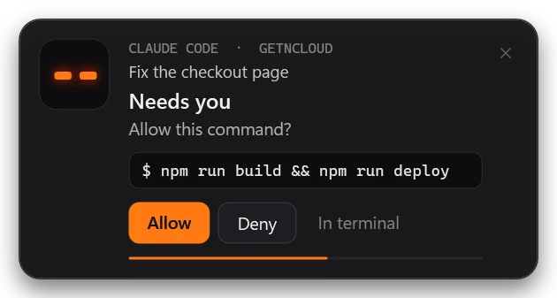
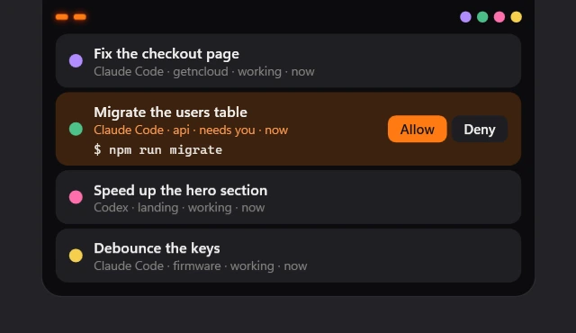
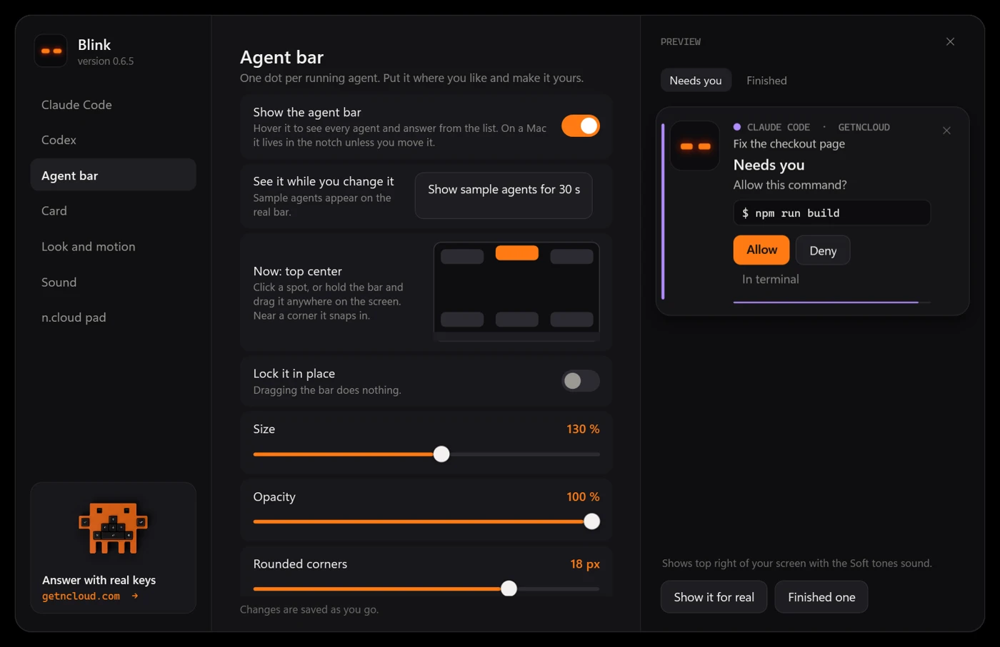

# Blink — your coding agent blinks when it needs you

Stop babysitting the terminal. **Blink** plays a soft sound and shows a small card when Claude Code or Codex:

- 🟠 **needs you**: a permission prompt ("Allow this command?") or a question;
- 🔵 **is done** with a long turn.

<p align="center"></p>

On Windows the card is Blink's own: two eyes that breathe orange while the agent waits and blink blue when it is done, the agent, the project and the session name, the exact command it wants to run, and **Allow / Deny right on the card** (quick replies, only for commands the card shows in full). It never steals focus. On a Mac with a notch it grows out of the notch (beta: built on first use with the Xcode command line tools, otherwise a regular notification). On Linux it uses the system notification.

Smart about it: it rings once per prompt (no double pings), stays quiet after quick answers you were watching anyway (finished in under 30 s), and skips the "still waiting" reminder right after a "done".

No dependencies, no network, no telemetry. A shell script plus, on Windows, one PowerShell helper you can read.

## Many agents at once

<p align="center"></p>

Run as many agents as you like. Each one gets its own colour, and a small bar at the top of the screen shows one dot per agent: it breathes when that agent needs you and fades when it is done. Hover to see them all, what each one is doing and for how long, and answer from the list. Click a dot to change the colour; it stays with that project.

On a Mac the bar lives in the notch: eyes on the left, agents on the right. A request opens the island with Allow and Deny. It builds itself the first time with `swiftc` from the Xcode Command Line Tools, and uses regular notifications until then or without them.

The eyes keep their meaning everywhere: blue works, orange needs you. The colour tells you who.

Make it yours in the settings: put the bar in any corner or drag it anywhere (Windows), change its size, opacity, corners and background, open the list on hover or on click, show it only when an agent needs you, pick the eye colours, where the card appears and how big it is, and how fast everything moves, or turn animation off.

The Blink icon sits by the clock on Windows and in the menu bar on a Mac: settings, the agent bar and sound are one click away.

## Install

```
/plugin marketplace add ccity2308-sudo/claude-plugins
/plugin install blink@ncloud
```

Then `/blink:test` to see and hear both cards, `/blink:settings` to tune it, `/blink:keys` for the single-key cheat sheet.

Using the Claude desktop app? Turn its own banners off in Settings → Claude Code → Notifications, so only Blink pops up.

## Settings

<p align="center"></p>

`/blink:settings` opens the settings window on Windows, also in Start as **Blink**. It saves as you go and shows a live preview of the card. Per agent: what to be called for (permission prompts, questions, finishing a task and how long it must have worked), the sound (Marimba, Soft tones, Desk bell, your Windows sounds, your own .wav or .mp3, or none) and the Allow / Deny buttons with how long to wait for a click. For the card: on or sound only, top right, top center or bottom right, how long it stays, and hiding the command while you stream. Volume and quiet hours.

The same settings are a plain `key=value` file (`%APPDATA%\blink\settings.conf` on Windows, `~/.config/blink/settings.conf` elsewhere). Env vars override it for one shell: `BLINK=0` (off), `BLINK_SOUND=0`, `BLINK_DESKTOP=0`, `BLINK_DONE=0`, `BLINK_THEME=glass`.

## Codex CLI

Codex runs one `notify` program when a turn ends. Point it at blink in `~/.codex/config.toml`:

```toml
notify = ["sh", "/path/to/claude-plugins/plugins/blink/scripts/bell.sh", "codex"]
```

Codex keeps a single `notify` entry: if you already have one, this replaces it. On Windows use Git Bash's `sh` (it comes with Git for Windows).

## Quick replies, exactly

When Claude Code asks for permission, the hook shows the card and waits (20 s by default) for your click. **Allow** or **Deny** answers that one prompt, the same as pressing it in the terminal. **In terminal**, or no click, leaves the prompt to you as usual. There is no "always allow" button on purpose.

## Answer without the mouse

At a permission prompt: `1`/`Enter` = allow, `2` = allow and don't ask again, `3`/`Esc` = no. `Shift+Tab` cycles auto-accept / plan mode.

Want those as real keys? **[n.cloud nc-xx](https://getncloud.com)** is a 9-key mechanical pad built for this — Allow, Reject, Enter and more, remappable. Works as a plain USB keyboard. 500 numbered units.

## License
MIT
